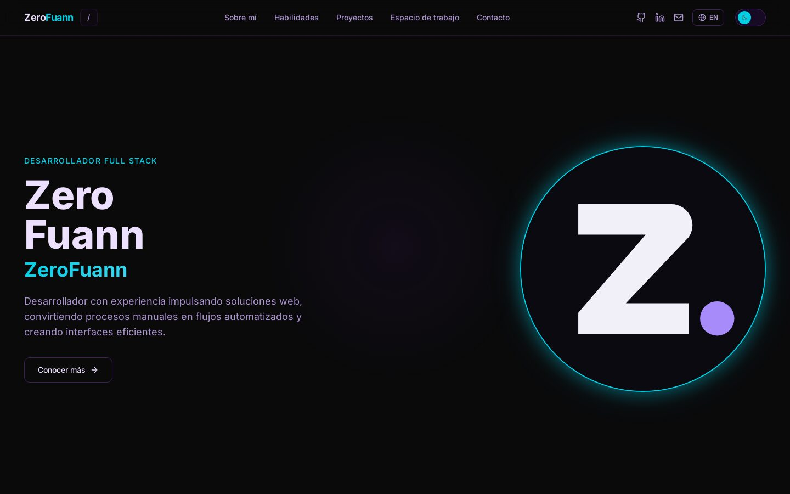
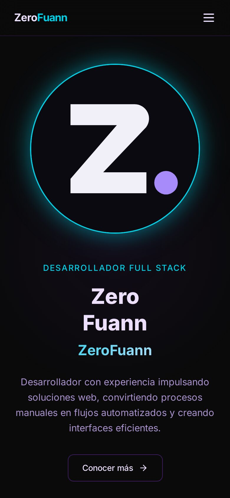
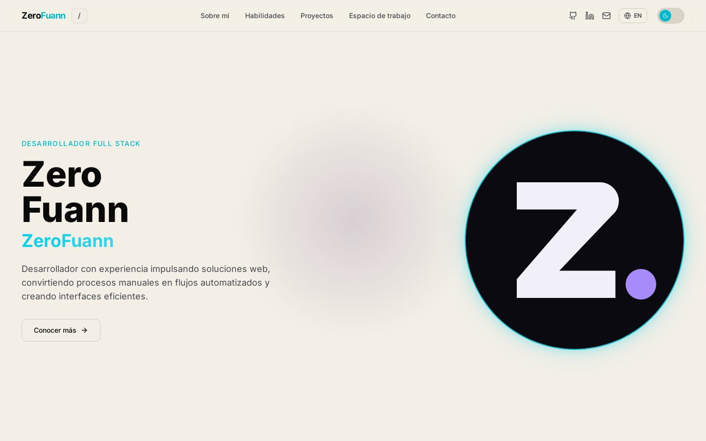
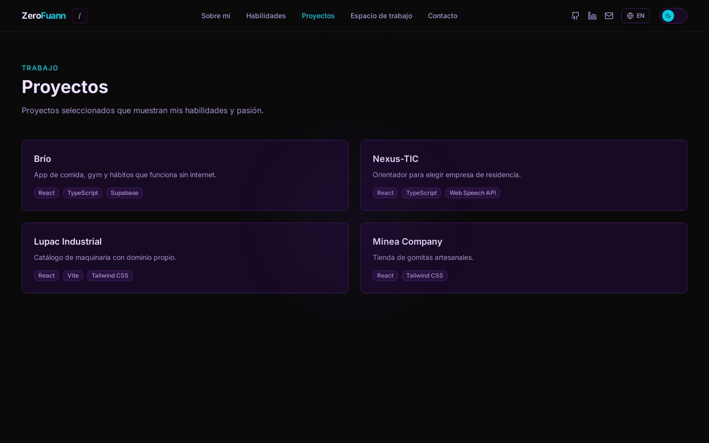
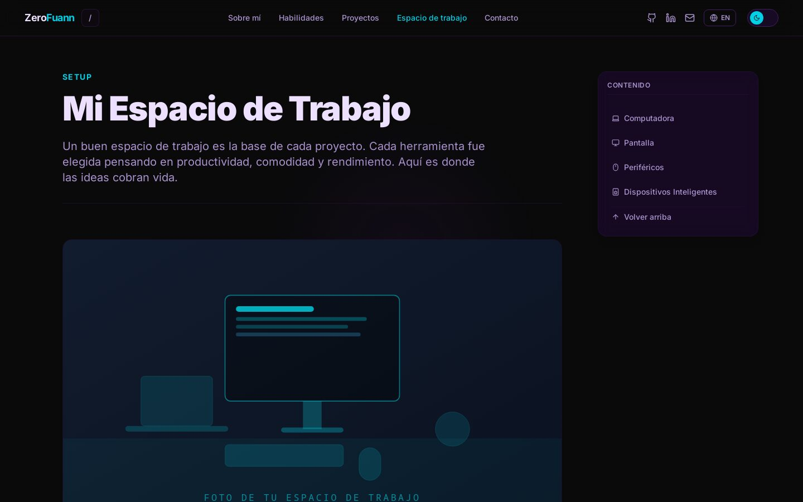

<div align="center">

# Plantilla de portafolio · React

**Portafolio moderno con varias páginas, modo claro/oscuro y español/inglés.** Cambia tus datos en un archivo y publícalo en minutos.

[**Ver demo**](https://cv-portafolio-zero-fuann.vercel.app) · [**Usar esta plantilla**](https://github.com/ZeroFuann-FS/plantilla-portafolio-react/generate)





</div>

> La demo usa los datos de **ZeroFuann** (su autor) como ejemplo. Al usar la plantilla, cámbialos por los tuyos: nombre, foto, enlaces y proyectos.

## Qué incluye

- Páginas de **inicio, sobre mí, habilidades, proyectos, espacio de trabajo** (con detalle de cada herramienta) y **contacto**.
- **Español e inglés** con un botón, y **modo claro y oscuro**.
- Animaciones con Framer Motion, efecto de luz que sigue al cursor y botón magnético.
- Proyectos con ventana de detalle, etiquetas y enlace a la demo.
- Botón para **descargar tu CV** (se oculta si no tienes uno).
- Componentes de [shadcn/ui](https://ui.shadcn.com) y diseño adaptable a celular.

| Modo claro | Proyectos | Espacio de trabajo |
|---|---|---|
|  |  |  |

## Cómo usarla

1. Da clic en **[Usar esta plantilla](https://github.com/ZeroFuann-FS/plantilla-portafolio-react/generate)** y clona tu copia.
2. Instala y corre:
   ```bash
   npm install
   npm run dev
   ```
3. Personaliza **dos archivos**:
   - **`src/config/perfil.ts`**: nombre, foto, correo, teléfono, redes, CV, enlaces y etiquetas de proyectos, e imágenes del equipo.
   - **`src/i18n/translations.ts`**: todos los textos en español e inglés (descripción, proyectos, equipo de trabajo).
4. Reemplaza las imágenes de `src/assets/`: tu foto, tu espacio de trabajo y tu equipo.
5. Opcional: pon tu CV en `public/cv.pdf` y escribe `cv: "/cv.pdf"` en `perfil.ts`.

Los textos para Google y redes sociales están en `index.html`. Los colores están en `src/index.css` (variables CSS) y `tailwind.config.ts`.

## Publicarla gratis en Vercel

Importa tu repositorio en [vercel.com/new](https://vercel.com/new) y da clic en *Deploy*: Vercel detecta Vite solo. El archivo `vercel.json` ya incluye la regla para que las rutas (`/projects`, `/contact`…) funcionen al recargar la página.

## Estructura

```
src/config/perfil.ts       ← tus datos e imágenes
src/i18n/translations.ts   ← textos en español e inglés
src/components/            secciones (Hero, Sobre mí, Proyectos, Workspace, Contacto…)
src/pages/                 páginas y rutas
src/assets/                foto, espacio de trabajo y equipo
public/                    favicon y archivos públicos (aquí va tu CV)
```

---

Hecha por [ZeroFuann](https://github.com/ZeroFuann-FS) · Licencia [MIT](LICENSE): úsala, modifícala y compártela libremente, conservando el aviso de licencia.
